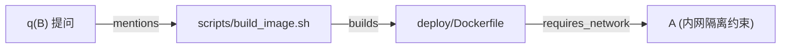

# 02 · 数学工具清单与选型论证

> 本文档系统梳理构建 `gp` 智能上下文选择器所需的 **7 类数学工具**。  
> 每一项均明确列出：**解决什么痛点、精确数学形式、参数含义、时间复杂度、已知理论坑与纠偏方案、以及对应到 `gp` 的数据结构**。

---

## 总览：数学工具与目标的映射矩阵

| 解决的工程痛点 | 核心数学工具 | 替代/对比工具 | 所在流水线阶段 |
| :--- | :--- | :--- | :--- |
| **A 与 B 表面无关，但通过多跳依赖关联** | **个性化 PageRank (PPR)** | 图热核扩散 ($e^{-tL}\mathbf{q}$) | 关联权重传播阶段 |
| **Top-K 选出重复废话，挤掉关键前提** | **成本感知次模优化 (Budgeted MMR)** | 预算贪心行列式点过程 (Budgeted k-DPP) | 子集选择与去冗余阶段 |
| **早期核心约定被遗忘 vs 一次性闲聊占位置** | **ACT-R 幂律激活 (Power-Law Forgetting)** | Per-Item 指数 IIR 衰减 | 时序记忆巩固阶段 |
| **高熵堆栈/UUID 噪音干扰 vs 精确符号丢失** | **条件信息增益 + BM25 / RRF 跨信号融合** | 裸 Surprisal（*仅作反例负对照*） | 节点先验打分阶段 |
| **自然语言摘要幻觉、漂移与不可仲裁** | **类型化状态机与约束账本 (DAG Provenance Ledger)** | —（替代不成立的卡尔曼滤波类比） | 低频基底状态维护 |
| **Token 省了但击穿 Prompt Cache 反而更贵** | **Prefix-Stability 约束下的成本背包规划** | 滑动窗口基线 | 最终 Prompt 编排阶段 |

---

## 工具 1：异构会话图上的个性化 PageRank（Personalized PageRank, PPR）

### 1.1 目的与动机
在 Coding Agent 场景中，“表面无关但实际有关”几乎全部来源于**结构性桥接**，而非文本语义相似。例如：
- 第 4 轮消息 $A$：用户说“*生产库在内网隔离区，禁止跑外部 curl 和 pip install*”。
- 第 38 轮消息 $C$：Agent 读取 `deploy/Dockerfile`，发现里面有构建脚本调用了内网镜像源。
- 第 92 轮提问 $B$：“*帮我修一下 `scripts/build_image.sh` 报 403 的问题*”。

$A$ 与 $B$ 的字面重合几乎为 0，余弦相似度极低；但在实体关系图上存在明确的多跳桥接路径：

### 1.2 数学定义
构建带权无向/有向异构图 $G = (V, E, W)$：
- **节点集合 $V = V_{\text{msg}} \cup V_{\text{ent}} \cup V_{\text{rule}}$**：
  - $V_{\text{msg}}$：会话历史条目（`SessionEntry` / 压缩切片 / 工具调用组）；
  - $V_{\text{ent}}$：从内容与工具参数中轻量抽取的**代码与运维实体**（文件路径、Go 包名/函数符号、错误码、命令名、数据库/配置键）；
  - $V_{\text{rule}}$：结构化约束账本中的约束节点。
- **边集合 $E$ 及权重 $W_{uv}$**：
  1. **包含边**（`entry` $\leftrightarrow$ `entity`）：同一条消息/工具输出提及某文件或符号（权重 $w_{\text{mention}}$，注意对高频停用实体做 IDF 逆文档频率降权，防止 `main.go` 变成超级枢纽吸干所有概率）；
  2. **因果/调用链边**（`tool_call` $\leftrightarrow$ `tool_result` $\leftrightarrow$ 相邻推理轮次）：同一 ReAct 步及相邻轮次的逻辑延续（权重 $w_{\text{causal}}$）；
  3. **代码结构边**（`file` $\leftrightarrow$ `imported_pkg` / `symbol`）：由轻量正则或 AST 关系建立（权重 $w_{\text{dep}}$）；
  4. **语义桥接边**（`entry_i` $\leftrightarrow$ `entry_j`）：仅当两节点余弦相似度 $\ge \tau_{\text{sim}}$（如 $0.75$）时连边，补足非代码概念的桥接。

定义转移概率矩阵 $\mathbf P$，其中 $P_{uv} = \frac{W_{uv}}{\sum_{k} W_{uk}}$（出度归一化；对枢纽实体采用度惩罚 $\tilde W_{uv} = \frac{W_{uv}}{\deg(v)^\beta}$，其中 $\beta \in [0.3, 0.5]$，避免“万能高频词”垄断游走路径）。

给定当前查询与近期活跃实体构造的**个性化种子分布** $\mathbf q \in \mathbb{R}^{|V|}$（满足 $\sum_i q_i = 1$），迭代求解稳态游走分布 $\mathbf r$：

$$
\mathbf r^{(k+1)} = (1 - \alpha)\thinspace\mathbf q + \alpha\thinspace\mathbf P^T \mathbf r^{(k)}
$$

- **阻尼/传送系数 $\alpha \in (0, 1)$**：控制多跳游走深度（通常取 $0.70 \sim 0.85$；期望游走跳数约为 $\frac{\alpha}{1-\alpha}$，当 $\alpha=0.75$ 时平均有效探索 3 跳，恰好覆盖 $B \to C \to A$）。
- **最终节点关联分**：取 $\mathbf{r}$ 投影到 $V_{\text{msg}}$ 上的分量 $r_i$，再做 $\log(1 + c \cdot r_i)$ 压缩以平滑长尾尺度。

### 1.3 复杂度与工程可行性
单个长会话中 $|V| \approx 10^2 \sim 10^4$，图极其稀疏（平均度 $< 15$）。采用幂迭代（Power Iteration）收敛 15–20 轮，或采用局部 Push 算法（Forward Push），在 Go 内存切片上耗时仅 **$< 2\text{ ms}$**。

---

## 工具 2：图热核扩散（Graph Heat Kernel Diffusion，作为 PPR 对照）

### 2.1 目的与定位
作为工具 1 的连续时间替代方案，在实验 `E2` 中对比检验：**连续扩散平滑是否比离散随机游走 PPR 更容易跨过嘈杂的弱连接？**

### 2.2 数学定义
定义对称归一化图拉普拉斯矩阵：

$$
\mathbf L_{\text{sym}} = \mathbf I - \mathbf D^{-1/2} \mathbf W \mathbf D^{-1/2}
$$

热量从种子分布 $\mathbf q$ 经过扩散时间 $t > 0$ 后的分布为：

$$
\mathbf h(t) = \exp(-t\thinspace\mathbf L_{\text{sym}})\thinspace\mathbf q = \sum_{m=0}^{\infty} \frac{(-t)^m}{m!}\thinspace\mathbf L_{\text{sym}}^m\thinspace\mathbf q
$$

- 与 PPR 的关键差异：PPR 的阶数权重呈几何衰减 $(1-\alpha)\alpha^m$，而热核按泊松权重 $e^{-t}\frac{t^m}{m!}$ 衰减；当 $t \approx 2 \sim 4$ 时，它对 **2–3 跳节点的权重惩罚比 PPR 更温和**，同时对高阶噪声压制更快。
- 工程上无需做矩阵特征分解，利用截断泰勒展开或切比雪夫多项式递推（$M = 6 \sim 10$ 阶矩阵-向量乘）即可在 **$< 3\text{ ms}$** 内完成近似求解。

---

## 工具 3：成本感知次模优化（Budgeted MMR）

### 3.1 目的与动机
直接按综合权重 $W(d_i)$ 取 Top-K 会面临两个经典失效：
1. **复读冗余**：某次排查连续执行了 6 次相似的 `grep` 或讨论同一报错，这 6 条得分都很高，把第 7 条权重略低但包含关键环境约束的条目挤出预算；
2. **大块头吞噬预算**：一条 3,000 token 的中等高分日志，直接吃掉本可以放 10 条高密度决策的额度。

### 3.2 数学定义（带 Token 成本归一化的贪心次模最大化）
令候选池为 $C$，已选工作集为 $S$，剩余 Token 预算为 $B_{\text{recall}}$，每条候选的占用长度为 $c_i = \text{EstimateTokens}(d_i)$。

在每一步贪心迭代中，寻找满足 $c_i \le B_{\text{rem}}$ 且**单位 Token 边际净收益最高**的条目：

$$
d^{\ast} = \arg\max_{d_i \in C \setminus S,\enspace c_i \le B_{\text{rem}}} \frac{\lambda \cdot \tilde W(d_i) - (1-\lambda)\thinspace\max_{d_j \in S} \text{Sim}(d_i, d_j)}{c_i^{\eta}}
$$

- $\lambda \in [0.5, 0.75]$：相关性与多样性权衡系数；
- $\text{Sim}(d_i, d_j)$：可用“向量余弦相似度”与“实体集合 Jaccard 相似度”的加权组合（编码场景下 Jaccard 对共享文件/报错行的去重极有效）；
- $\eta \in [0, 1]$：长度成本惩罚指数。当 $\eta = 0$ 时退化为标准 MMR；当 $\eta \in [0.5, 1.0]$ 时构成**预算背包次模贪心**，偏好信息密度高的短条目，同时防止超大工具输出独占预算（大工具输出已有 `restore_observation` 兜底）。

### 3.3 复杂度
若候选池先经初筛截断至 $N \le 200$ 条，选出 $k \le 20$ 条，总共只需约 $k \cdot N \approx 4000$ 次轻量向量点积/集合交并，耗时 **$< 1\text{ ms}$**。

---

## 工具 4：预算约束行列式点过程（Budgeted k-DPP，作为 MMR 理论上限对照）

### 4.1 目的与动机
MMR 只考虑与“已选集合中**最相似的某一条**”的成对排斥（pairwise max-similarity）；当多条信息在特征空间里**线性相关（张成同一子空间，但两两余弦都不算极端高）**时，DPP 能从**全局子空间体积**角度彻底消除共线性冗余。

### 4.2 数学定义
构造半正定质量-多样性核矩阵 $\mathbf L \in \mathbb{R}^{N \times N}$：

$$
L_{ij} = \tilde W(d_i) \cdot \langle \boldsymbol \phi_i, \boldsymbol \phi_j \rangle \cdot \tilde W(d_j)
$$

其中 $\boldsymbol \phi_i$ 为单位化语义特征向量（满足 $\Vert\boldsymbol \phi_i\Vert_2 = 1$）。选出子集 $S$ 的联合收益为子矩阵行列式：

$$
P(S) \propto \det(\mathbf L_S)
$$

几何意义上，$\sqrt{\det(\mathbf L_S)}$ 等于带权向量集合 $\lbrace \tilde W(d_i)\boldsymbol \phi_i \mid i \in S \rbrace$ 在高维空间张成的**超平行多面体体积**：
- 若新加入条目可被已选条目线性表出（语义已被覆盖），行列式增量趋近于 $0$；
- 若新条目同时具备**高自身权重 $\tilde W$** 与 **正交互补信息**，行列式增益最大。

利用**增量 Cholesky 分解快速贪心 MAP 推理**（Chen et al., NeurIPS 2018 经典加速算法）：每轮通过递推更新正交残差向量长度 $d_i^2$，可在 $O(k^2 N)$ 复杂度内选出最优子集（实测在 $N=200, k=20$ 下仅需 **$< 2\text{ ms}$**），并在实验中直接与 MMR 比对效果与稳定度。

---

## 工具 5：ACT-R 幂律激活与记忆巩固（Power-Law Forgetting）

### 5.1 目的与对 Hawkes 误区的修正
我们需要一种时序权重函数，能够自然区分：
- **一次性过程噪音**（第 12 轮试错了一个错误命令，之后再也没人提过）$\rightarrow$ 快速衰减；
- **反复被强化/引用的基础设定**（第 5 轮定下的协议约定，在第 30、65、88 轮均被引用或关联修改）$\rightarrow$ 即使距今已过百轮，依然保持高激活度。

**修正说明**：标准 Hawkes 自激点过程采用全局常数衰减率 $\gamma$，指数衰减叠加脉冲在数学上等价于一阶 IIR 低通滤波，在多轮后仍会较快遗忘长程约束；若强行按节点修改 $\gamma$ 又缺乏严谨参数依据。因此改用认知科学中被大量验证的 **ACT-R 基础激活方程（Base-Level Learning Equation）**。

### 5.2 数学定义
设条目 $i$ 在历史上被“创建、显式引用、工具 `restore_observation` 调回、或关联实体被修改”的轮次索引集合为 $\lbrace t_1, t_2, \dots, t_m \rbrace$（均满足 $t_k < t_{\text{now}}$）：

$$
B_i(t_{\text{now}}) = \ln \left( \sum_{k=1}^{m} \left( \Delta t_k + \delta \right)^{-d} \right)
$$

归一化为时间激活因子（经过 Sigmoid 映射到 $(0, 1)$）：

$$
W_{\text{time}}(i, t_{\text{now}}) = \sigma\left(\frac{B_i(t_{\text{now}}) - \tau_B}{s}\right)
$$

- $\Delta t_k = t_{\text{now}} - t_k$：以逻辑轮次（Turn）或有效操作步数计，避免受人工挂机/休息的物理墙上时间干扰；
- $d \in [0.35, 0.65]$：幂律衰减指数（ACT-R 经典值为 $0.5$）；
- $\delta = 1.0$：防奇异平滑常数。

**幂律（Power-law）相对指数衰减的优势**：具有重尾特性——单次出现会平滑衰减让出空间，而只要在不同时间跨度被反复强化（间隔效应 Spacing Effect），其历史长尾贡献会长期保持高位。

---

## 工具 6：任务条件信息增益与跨信号融合（取代裸 Surprisal）

### 6.1 明确禁止使用裸 Surprisal（$-\log P(x_i \mid x_{<i})$）
在本项目实验设计中，裸 Surprisal **只能作为反证负对照组 `E5` 出现，绝不进入推荐链路**。理由如下：
1. **高熵 $\neq$ 高价值**：十六进制内存地址、UUID、Go stack trace、长 URL、JSON 原始转储都具有极高的语言模型惊讶度，但绝大多数属于低价值噪音；
2. **自恋偏差（Narcissism Bias）**：用同一模型评估自身历史输出时，模型会系统性地认为他人约束“意外度不同”，导致权重失真；
3. **额外延迟与成本**：逐条对历史跑一次前向算 logprob 会引入高昂额外计算。

### 6.2 替代方案：稀疏精确匹配 + 语义相似度 + 结构角色先验（RRF 融合）
在 Coding Agent 场景中，**精确标识符（函数名、错误码 `E1042`、文件路径、配置 key）** 往往比泛化语义更致命——向量 Embedding 会把 `v1/user` 和 `v2/user` 混为一谈，而稀疏检索不会。

对候选条目 $d_i$ 构造面向当前 Query $q$ 的多路相关性信号：
1. **稀疏精确信号 $S_{\text{BM25}}(d_i, q)$**：基于代码分词器（按驼峰、下划线、路径斜杠切词）的 BM25 分数；
2. **稠密语义信号 $S_{\text{dense}}(d_i, q)$**：向量余弦相似度；
3. **图多跳信号 $S_{\text{PPR}}(d_i, q)$**：工具 1 输出的个性化 PageRank 分数；
4. **结构信息密度惩罚 $\rho(d_i)$**：对纯格式/超低独特词占比（如重复堆栈行、超长 JSON 列表、客套确认语 `"好的，我明白了"`）通过压缩比（`zlib` 压缩率或唯一 token 比）施加降权惩罚，而非用 $-\log P$ 加权！

使用带权 **倒数排名融合（Weighted RRF）** 或标准化加权融合得到单节点基础质量分 $W(d_i)$：

$$
W(d_i) = W_{\text{time}}(i, t_{\text{now}}) \cdot \rho(d_i) \cdot \left( \omega_1 \hat S_{\text{PPR}} + \omega_2 \hat S_{\text{BM25}} + \omega_3 \hat S_{\text{dense}} \right)
$$

再送入工具 3（Budgeted MMR）或工具 4（Budgeted k-DPP）完成最终去冗余工作集挑选。

---

## 工具 7：缓存感知成本模型与前缀稳定性优化

### 7.1 目的与核心矛盾
在 LLM API 计费体系下，单纯减少 `TotalInputTokens` 不等于降低真实成本。记单轮真实输入成本函数为 $C_{\text{in}}(t)$：

$$
C_{\text{in}}(t) = c_{\text{base}} \cdot T_{\text{uncached}}(t) + c_{\text{read}} \cdot T_{\text{read}}(t) + c_{\text{write}} \cdot T_{\text{write}}(t)
$$

通常 $c_{\text{read}} \approx 0.10 \sim 0.50 \cdot c_{\text{base}}$，而一旦前部任意 1 个 token 被改动（内容变化或顺序重排），**该位置之后的全部后缀都会失去前缀缓存命中**，退化为全价 $c_{\text{base}}$（甚至额外支付 $c_{\text{write}}$）。

### 7.2 结合 `gp` 现状的两个关键数学建模点
1. **Epoch 冻结掩码替代每轮滑动掩码**：
   - `gp` 当前的 `applyObservationMasking(..., 5)` 每新增 1 轮工具调用都会改写第 $T-5$ 轮的内容，导致前缀缓存最长只能复用最后几百 token。
   - 改进思路（在实验 `E4` 验证）：按固定 **Epoch 步长 $E$（如每 8 轮或每累积 16k tokens）** 触发一次“批量折叠 + 基底增量提交”，在同一个 Epoch 内保持历史前缀 **严格只追加、零修改（Append-Only）**，从而连续 $E$ 轮吃满前缀缓存。
2. **工作集三段式拼接顺序优化（待实验仲裁的两个候选布局）**：
   - **布局 A（稳定基底在前，召回居中，高频在后）**：
     `[System + 工具定义 + 结构化约束账本] → [动态召回工作集 S] → [高频滑窗 + 当前 Query]`
     - *优点*：高优先级的近期原始对话最靠近 Query，符合模型近因注意力（Recency Bias）；
     - *缺点*：每次 $S$ 变动，都会击穿其后整个高频滑窗的缓存。
   - **布局 B（前缀全静态追加，召回置尾紧贴 Query）**：
     `[System + 工具定义 + 结构化约束账本] → [Epoch 内只增不减的高频滑窗] → [动态召回工作集 S + 当前 Query]`
     - *优点*：从开头直到高频滑窗结束全部稳定可缓存，缓存命中率极高；
     - *缺点*：需要验证召回块夹在高频滑窗与 Query 之间是否影响多轮工具链的指令遵循精度。

这两个布局与 `Epoch 冻结掩码` 将在 [04 - 实验设计与评测基准](04-实验设计与评测基准.md) 中通过 `E4` 对照组直接用真实账单与准确率跑分来一决高下。
