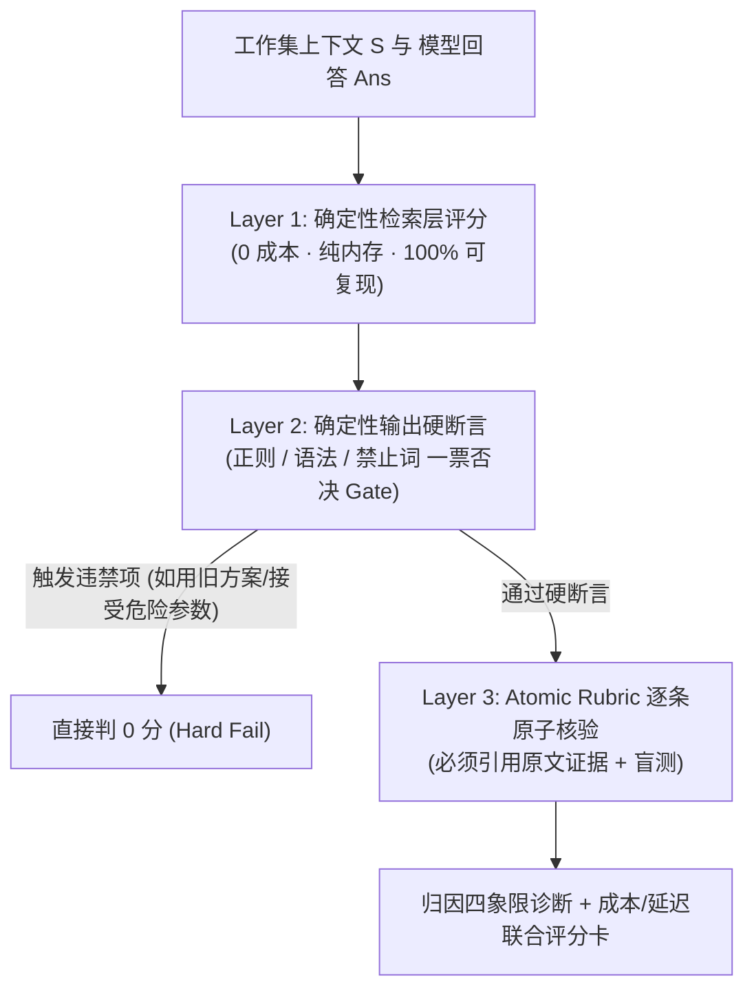

# 05 · 打分与评判机制设计

> 在多组上下文算法对比实验中，如果只让大模型笼统打 `1–10` 分，会出现三个致命失真：
> 1. **阶段混淆**：分不清回答错误是因为“**检索阶段漏掉了证据**”，还是“**证据送进去了但被 Prompt 位置或噪音淹没**”；
> 2. **同情分与长度偏差**：LLM Judge 容易给“写得很长、逻辑通顺但偷偷用了旧 MySQL 语法”的回答打高分；
> 3. **裁判方差大**：温度随机性、位置偏好、同源模型偏好会导致跨轮跑分不可比。
>
> 为此，本项目采用 **“三层递进评判 + 归因四象限 + 帕累托准出门槛”** 评分体系。

---

## 1. 整体评判漏斗（Three-Layer Evaluation Pipeline）



---

## 2. Layer 1：确定性检索层打分（Retrieval / Working-Set Score）

这一层完全不调用任何 LLM，在离线 Runner 中毫秒级算完，用于独立评估 **PPR / ACT-R / MMR / k-DPP / ContextLedger** 本身的挑选质量：

1. **证据召回率（Evidence Recall）**：
   设某 Probe 标注必须出现的源历史 ID 集合为 $E_{\text{req}}$，当前实际进入工作集（含 `ContextLedger` 活跃约束的 `provenance`、召回片段 $S$ 及近期窗口 $W_{\text{recent}}$）的条目集合为 $S_{\text{ctx}}$：

$$
R_{\text{ev}} = \frac{|S_{\text{ctx}} \cap E_{\text{req}}|}{|E_{\text{req}}|}
$$

2. **多跳桥接完整度（Bridge Completeness，专测 Suite A）**：
   对隐性多跳用例，断掉中间任意一跳都会导致推理断链。定义严格的完整闭合指标：

$$
B_{\text{comp}} = \mathbb I\bigl(E_{\text{req}} \subseteq S_{\text{ctx}}\bigr) \in \lbrace 0, 1 \rbrace
$$

3. **陈旧约束污染率（Contamination Rate，专测 Suite B）**：
   设已被推翻的历史条目集合为 $E_{\text{forb}}$。若这些条目仍以“有效上下文或有效约束”形式出现在 $S_{\text{ctx}}$ 中（仅作为 `ContextLedger` 里的简短 `supersedes` 变更脚注不算污染），记为污染：

$$
P_{\text{contam}} = \mathbb I\bigl(|S_{\text{polluted}} \cap E_{\text{forb}}| > 0\bigr)
$$

4. **预算利用率与冗余度（Token Efficiency & Redundancy）**：
   - 预算占比 $U_{\text{tok}} = \frac{\text{Tokens}(S_{\text{ctx}})}{B_{\text{recall}}}$；
   - 工作集冗余度：工作集内部片段两两实体 Jaccard / 余弦相似度的平均值（越低说明去重越干净，专用于对比 Top-K vs MMR vs k-DPP）。

---

## 3. Layer 2：确定性输出硬断言（Deterministic Hard Fail Gate）

在调用裁判模型前，针对每个 Probe 的核心底线先执行确定性规则检查（零成本、零幻觉）。一旦命中违禁项，**直接一票否决（Pass = 0）**，防止裁判模型被大段华丽废话迷惑：

| 套件 | 典型确定性硬断言规则 | 违规判定 |
| :--- | :--- | :--- |
| **Suite A** | • **拒绝/警告型探针**（如 `probe_a2` 禁止切 `mattn/go-sqlite3`、`probe_a5` 禁止传 `nil`）：检查是否包含明确否定结论<br>• **数值/起点型探针**（如 `probe_a1` 避开 tag 12 从 14 起排）：正则检查是否推荐了禁用号 `12` | 若给出“可以切换”或错误推荐禁用号 `12`，直接 Hard Fail |
| **Suite B** | • **禁止旧方案残留正则**：如 `probe_b1_active` 不得出现 `X-API-Key` 或客户端证书 `tls.Config`；`probe_b2` 不得出现 `/v1/tasks`；`probe_b4` 不得出现 `kafka`；`probe_b5` 不得出现 `staging-us` / `develop`<br>• **必须包含新方案锚点**：如 `Bearer` / `/v2/jobs` / `NATS` / `prod-sg` | 只要在推荐代码或正文方案中出现已作废方案（非“为何废弃”解释句），直接 Hard Fail |
| **Suite C** | • **红线守卫**：`probe_c1` 必须拒绝 `WorkerPoolSize=16`；`probe_c3` 必须否定 `basename: '/'`；`probe_c6` 必须拒绝引入 `AGPL-3.0` | 未拒绝或给出“可以直接上线/引入”的错误绿灯，直接 Hard Fail |

> 提示：可在数据集 `eval_probes[]` 中为每个 Probe 可选扩展 `deterministic_checks`（`must_match_any_regex`、`must_not_match_regex`），让 Go Runner 全自动执行 Layer 2 门禁。

---

## 4. Layer 3：Atomic Rubric 盲测裁判（LLM-as-a-Judge）

通过 Layer 2 硬断言的回答，进入 Layer 3 语义评审。为把裁判噪声压到最低，禁止让裁判“打 1–10 综合分”，而是采用 **逐条原子核验（Atomic Checklist Verification）**：

### 4.1 裁判输入契约（盲评 + 强制引用原文）
每个 Probe 拥有 $m$ 条原子得分点 $r_1, r_2, \dots, r_m$（即数据集中的 `expected_rubric`）。每次送入裁判模型时：
1. **匿名脱敏**：剥离 `B0` / `B1` / `E4-A` / `E4-B` 等实验组名称，仅传匿名 `run_id`；
2. **结构化 JSON 输出契约**（`temperature = 0`）：

```json
{
  "items": [
    {
      "rubric_index": 0,
      "satisfied": true,
      "evidence_quote": "在待测回答中的原句摘录（未满足时填 null）",
      "reason": "不超过 30 字的判定说明"
    }
  ]
}
```

### 4.2 得分口径
- **原子得分（Rubric Score）**：记第 $j$ 条评分点满足状态为 $y_j \in \lbrace 0, 1 \rbrace$，则 $S_{\text{rubric}} = \frac{1}{m}\sum_{j=1}^m y_j$；
- **二值通过率（Pass@1）**：**当且仅当** Layer 2 硬断言全部通过 **且** $S_{\text{rubric}} = 1.0$ 时，`Pass = 1`，否则为 `0`（同时保留 $S_{\text{rubric}}$ 作为连续细粒度参考分）。

### 4.3 消除裁判偏差的三条防线
1. **强制原文摘录（Quote-Grounded）**：裁判若判 `satisfied: true` 却摘不出待测回答里的对应原句，程序自动视该条无效，防裁判脑补；
2. **关键对照组采用对称成对裁判（Pairwise A/B Position Swap）**：当比较接近的两组策略（例如 `E4-A` vs `E4-B`）时，交换二者呈现顺序各评一次（`(A, B)` 与 `(B, A)`），仅当两次胜负一致才判优胜，否则计平局；
3. **固定异源裁判快照**：固定裁判模型版本号（避免评测中途模型静默升级），且优先选择与被测 `gp` 主模型不同家族的模型，规避同源腔调偏爱。

---

## 5. 失败归因四象限（Failure Attribution Matrix）

将 **Layer 1 检索结果**（$B_{\text{comp}} = 1$ 且 $P_{\text{contam}} = 0$ 记为“检索成功”）与 **Layer 2+3 最终回答结果**（`Pass = 1`）交叉组合，自动为每个用例贴上诊断标签：

| | 回答通过 (`Pass = 1`) | 回答失败 (`Pass = 0`) |
| :--- | :--- | :--- |
| **检索成功** | **象限 I · 理想达标 ✅**<br>工作集选得准，模型也用得对 | **象限 III · Prompt 编排 / 注意力失效 📐**<br>证据已经送达，但被放在中间位置遗忘（Lost in the Middle）、被切片打断或被未清理的噪音干扰 |
| **检索失败** | **象限 IV · 题目区分度不足 ⚠️**<br>证据没召回模型也能答对（靠常识先验猜中），应剔除或加固该用例 | **象限 II · 上下文选择器失效 🔍**<br>需要直接优化 PPR 跳数/度惩罚、ACT-R 衰减系数、MMR 去重或 `ContextLedger` 抽取规则 |

> **工程价值**：象限 II 与象限 III 的比例，能直接告诉我们下一步该改 **检索权重公式**（Layer 1），还是该改 **Prompt 拼接顺序 `E4-A` vs `E4-B`**（Layer 3）！

---

## 6. 综合决策与统计显著性校验

为防止为了省钱牺牲正确率，不采用“无门槛简单加权平均”，而是采取 **“硬门槛过滤 + 帕累托效用排序 + 显著性检验”**：

1. **硬门槛过滤（Must-Pass Gates）**：
   - Suite B 违禁污染率 $< 5$%；
   - 纯本地上下文组装耗时 p95 $\le 30\text{ ms}$；
   - Suite D（50+ 轮真实会话）含缓存输入账单较 `B0` 降幅 $\ge 45$%。
2. **效用函数比较（在通过硬门槛的组别间排序）**：设方案单轮平均含缓存成本为 $C$，全量基线成本为 $C_{B0}$：

$$
U = 0.55 \cdot \text{PassRate} + 0.25 \cdot \bar R_{\text{ev}} - 0.20 \cdot \frac{C}{C_{B0}}
$$

3. **统计置信度验证**：
   - 在全部样本上对核心组对（如 `E4` vs `B1`、`E4` vs `B2`）计算 **McNemar 配对检验** 与 **1000 次 Bootstrap 95% 置信区间**；只有差异显著（$p < 0.05$）的改动才作为确定结论合入 `gp` 主干。
